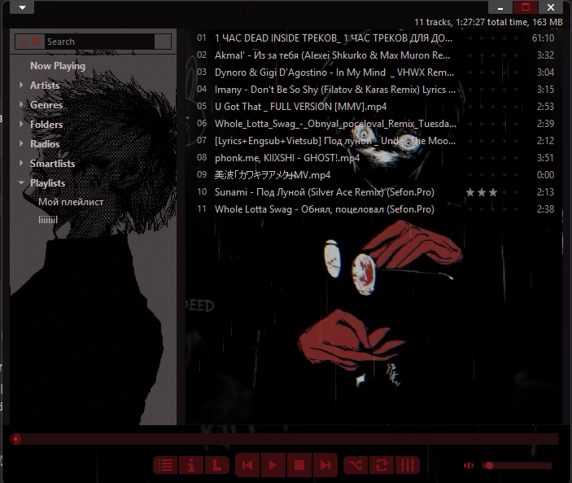

# Winyl Anime — Music Player for Windows

**Winyl Anime** is a Windows music player and audio media player based on Winyl 3.3.1. This community fork combines music playback with a ready-made Tokyo Ghoul anime theme and an editor for customizing skins, backgrounds and buttons.



## Features

- **Tokyo Ghoul theme:** Kaneki backgrounds, dark colors and red accents.
- **Skin editor:** browse images by category, preview and replace backgrounds, buttons, covers and other elements, and adjust playlist and library backgrounds.
- **Easy installation:** install the player with the theme included, then add `.wzp` skins or unpacked skin folders from the skin dialog.
- **Clear playback controls:** enabled Repeat, Shuffle and Mute buttons have a visible highlight.
- **Player fixes:** more reliable button clicks and adaptive backgrounds that stay in place while scrolling.

## Download and install

1. Download **`WinylAnime_Setup_x86.exe`** from the [latest release](https://github.com/qexdy3/winyl-anime/releases/tag/v3.3.1-easy-install).
2. Run the installer and follow the setup wizard. The Tokyo Ghoul theme and required audio libraries are included.
3. Launch Winyl Anime. A fresh installation opens with the Tokyo Ghoul theme selected.

The installer creates a separate portable profile, so an existing Winyl installation and library are left untouched. Music must be added to the new profile. It installs per-user by default and preserves existing settings and edited skin files on upgrade. The installer is not digitally signed, so Windows may display a warning.

The player is a **32-bit (x86)** Release build. Installer SHA-256: `C03761BBDFFBD9B11F88D282B930ECCA91E1F9AA5509E713C0BACA616D0017E1`.

### Install more skins

Press **F4** to open the skin dialog. Click **Install...** to add a Winyl `.wzp` package, or **Add folder...** to add an unpacked skin containing `Skin.xml` and `SkinInfo.xml`. Existing skins with the same name are not overwritten. Extract ordinary `.zip` archives before using **Add folder...**. Select the new skin and click **Apply**.

## Customize a skin

Press **F4**, select an unpacked skin and click **Edit...**. Choose a category and preview an image before replacing it, or change the playlist and library background color and display mode. Changes are saved immediately, and original files are kept alongside them with the `.winyl-original` extension. Categories are based on common folder names; **All images** includes every supported image.

Packed `.wzp` skins must first be extracted into a folder inside `Skin`; reopen the skin dialog afterwards. Closing the editor reloads the active skin and stops playback.

## Build

Build `Winyl.sln` using Visual Studio 2017 with C++ Windows XP support and the `v141_xp` toolset:

```bat
msbuild Winyl.sln /p:Configuration=Release /p:Platform=x86
```

The output is `Release\Winyl.exe`. See [BUILD.md](BUILD.md) for dependencies. To build the installer, use Inno Setup 5.6.1 and `installer/build-installer.ps1` with paths to the compiler and an existing Winyl runtime containing the audio libraries, languages and bundled skins. The historical [patch](Winyl_3.3.1_fixes.patch) contains the earlier button and background fixes; the current source also includes the skin editor and toggle indicators.

## Credits and license

Based on Winyl 3.3.1 by Alex Kras. The player source is licensed under the [GNU GPL v3](LICENSE). BASS and its add-ons have [separate licensing terms](https://www.un4seen.com/bass.html#license); BASS is free for qualifying non-commercial use. Tokyo Ghoul names and artwork may belong to their respective rights holders.
