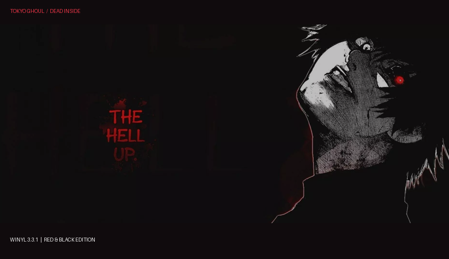

# Winyl Anime

Bring a dark anime aesthetic to your music. **Winyl Anime** is a community fork of Winyl 3.3.1 featuring a ready-made Tokyo Ghoul theme and tools for customizing your own skins.



## Features

- **Tokyo Ghoul theme:** Kaneki backgrounds, dark colors and red accents.
- **Skin editor:** replace backgrounds, buttons and other skin images; adjust playlist and library background colors and display modes.
- **Clear playback controls:** enabled Repeat, Shuffle and Mute buttons have a visible highlight.
- **Player fixes:** more reliable button clicks and adaptive backgrounds that stay in place while scrolling.

## Download and install

1. Download `Winyl_x86.exe` and `Tokyo_Ghoul_No_Blue_Icons.zip` from the [latest release](https://github.com/qexdy3/winyl-anime/releases/tag/v3.3.1-skin-editor).
2. Use the executable with an existing Winyl installation. It requires the BASS DLLs (`bass.dll`, `bassmix.dll`, `bassasio.dll`, `basswasapi.dll` and `bass_fx.dll`) next to it; these are not included in this repository.
3. Extract the theme folder into the player's `Skin` folder. In Winyl, press **F4** and select **Tokyo_Ghoul_No_Blue_Icons**.

The executable is a **32-bit (x86)** Release build. SHA-256: `0B900F56E2650D84806CABD3847863007EA3AFD312AB21446839C37C32861BCE`.

## Customize a skin

Press **F4**, select an unpacked skin and click **Edit...**. Choose an image to replace or restore, or change the playlist and library background color and display mode. Changes are saved immediately, and original files are kept alongside them with the `.winyl-original` extension.

Packed `.wzp` skins must first be extracted into a folder inside `Skin`; reopen the skin dialog afterwards. Closing the editor reloads the active skin and stops playback.

## Build

Build `Winyl.sln` using Visual Studio 2017 with C++ Windows XP support and the `v141_xp` toolset:

```bat
msbuild Winyl.sln /p:Configuration=Release /p:Platform=x86
```

The output is `Release\Winyl.exe`. See [BUILD.md](BUILD.md) for dependencies. The historical [patch](Winyl_3.3.1_fixes.patch) contains the earlier button and background fixes; the current source also includes the skin editor and toggle indicators.

## Credits and license

Based on Winyl 3.3.1 by Alex Kras. The player source is licensed under the [GNU GPL v3](LICENSE). Tokyo Ghoul names and artwork may belong to their respective rights holders.
